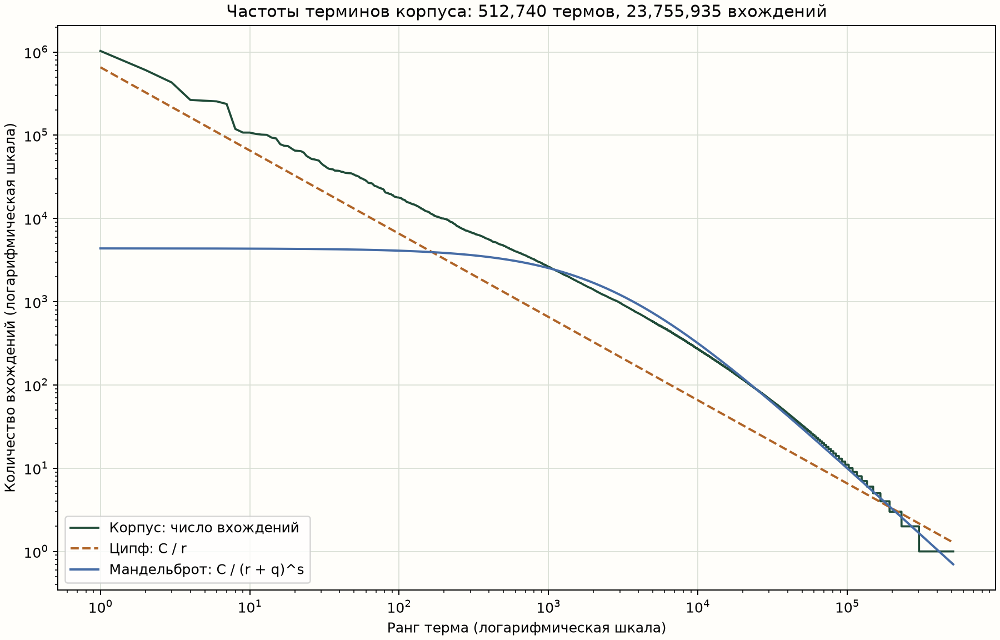

# Закон Ципфа и модель Мандельброта

## Корпус и частота

Использована подготовленная выгрузка ЛР1 от 6 ноября 2026 года:
**82 889 документов**, **512 740 различных термов**, **23 755 935 вхождений**.
Частота `cf(t)` — число всех вхождений терма в заголовках и статьях, включая
повторы в одном документе. URL не учитываются. Применяются прежние правила
токенизации и нижний регистр; стоп-слова и числа сохраняются. График построен
для исходных словоформ, до объединения основ при поиске.

Длина списка документов `df(t)` показывает присутствие терма, а не число его
повторений. Поэтому индексатор теперь накапливает `cf` до удаления повторов,
суммирует счётчики при сборке словаря и сохраняет их в секции 6 BIDX 1.2.
Читатель проверяет `cf ≥ df` и `Σ cf = N`. Размер текущего индекса —
**103 489 660 байт**. Добавлено `8V + 32 = 4 101 952` байта относительно BIDX 1.1.
[Описание формата](../FORMAT.md).

Независимый Python-проход сравнил **все 512 740 частот** с C++ и подтвердил
полное совпадение. Секции документов, словаря, списков и базовой статистики
побайтно совпадают с прежним BIDX 1.1.
[Результат сверки](test-results/frequency-validation.json).

## Модели и метод подбора

Термы упорядочиваются собственной сортировкой слиянием по убыванию `cf`;
при равных частотах используется лексикографический порядок словаря.
Каждый терм получает отдельный ранг от 1 до V.

Закон Ципфа задаёт `f(r) = C / r`, то есть прямую с наклоном −1 на графике
`log(r), log(f)`. Это модель частот вхождений.
[Introduction to Information Retrieval](https://nlp.stanford.edu/IR-book/html/htmledition/zipfs-law-modeling-the-distribution-of-terms-1.html).
Для всех наблюдаемых рангов выбрана константа
`ln C = mean(ln cf(r) + ln r)`: она минимизирует сумму квадратов логарифмических
остатков при фиксированном наклоне −1.

Дополнительно использована модель `f(r) = C / (r + q)^s`.
[Описание модели Zipf–Mandelbrot](https://files.ele-math.com/articles/mia-21-42.pdf).
Для `q` проверяются ноль и 64 точки, равномерные по `ln(1+q)`, в диапазоне
`[0,V]`. Для каждого кандидата линейная регрессия `ln cf` на `ln(r+q)`
определяет `s` и `ln C`; допускаются положительные конечные C и s.
В окрестности лучшего кандидата выполняются 32 уточнения золотым сечением.
Сравнивается `RMSE(log10) = sqrt(mean((log10 f − log10 cf)^2))`.

Все ранги имеют одинаковый вес. Это аппроксимация абсолютных частот в
логарифмах: сумма значений линии не принуждается к N. Параметры вычисляются
в C++ по полным данным, без библиотек подбора. Python/Matplotlib только
отображает уже экспортированные частоты и значения моделей.
[ZipfAnalysis](../analysis/src/zipf_analysis.cpp).

## Измеренный результат

| Модель | C | q | s | RMSE(log10) |
|---|---:|---:|---:|---:|
| Ципф | 655777,267170 | 0,000000 | 1,000000 | 0,246492 |
| Мандельброт | 1781845098,202252 | 2552,326134 | 1,646688 | 0,079189 |




[Векторный SVG](figures/zipf-corpus.svg) ·
[Полная таблица 512 740 рангов, gzip TSV](../data/zipf-frequencies.tsv.gz) ·
[Параметры и точки API](../data/zipf-metrics.json).

Самый частый терм `в` встречается **1 030 173** раза, затем идут `и`
(607 940), `на` (430 903) и `не` (265 551). Термы с одним вхождением —
**210 152**, или примерно **40,99 %** словаря. Равные целочисленные частоты
образуют хорошо заметные ступени в правой части графика.

Расхождения с законом Ципфа видны и в голове, и в хвосте. Фактический наклон
не постоянен: одна прямая с наклоном −1 не описывает весь диапазон. Большое
число редких словоформ, имён и числовых токенов и конечный размер корпуса
дают длинный дискретный хвост. Сохранённые служебные слова образуют голову.
Разные жанры новостей и особенности правил токенизации также могут влиять
на форму распределения. Доля каждого из этих факторов отдельно не измерялась;
это объяснения наблюдаемого отклонения, а не доказанные причинные вклады.

У Мандельброта ниже общая логарифмическая ошибка, но голова описывается плохо:
на первом ранге модель предсказывает около **4 369** вхождений вместо
**1 030 173**. Причина выбора такого результата — критерий подбора: сотни
тысяч рангов хвоста имеют суммарно гораздо больший вес, чем первые десятки
слов. Улучшение общей ошибки не означает точного описания наиболее частых
термов. Подбор на отдельных диапазонах или иной вес рангов изменит параметры;
в данной работе для воспроизводимости сохранён единый критерий по всем рангам.

## Веб-интерфейс и воспроизведение

Раздел «Ципф» показывает распределение активного индекса, обе линии и константы.
`GET /api/analysis/zipf` отдаёт до 2 000 точек на логарифмически выбранных
рангах; для этого корпуса показано 1 387 разных рангов после удаления повторов.
Подбор выполнен по всем 512 740 рангам. `?format=tsv` выгружает полную таблицу.
При загрузке другого индекса данные обновляются; устаревшие ответы игнорируются.
Для BIDX 1.0/1.1 поиск доступен, а API анализа возвращает `available:false`
и предложение перестроить индекс. Пустой индекс не содержит линий моделей.

Для получения standalone-графиков из корня репозитория:

```sh
python3 -m venv search/build-analysis
search/build-analysis/bin/python -m pip install -r search/tools/requirements-analysis.txt
MPLCONFIGDIR="$PWD/search/build-analysis/mplconfig" \
  search/build-analysis/bin/python search/tools/plot_zipf.py \
  search/data/zipf-frequencies.tsv.gz search/data/zipf-metrics.json \
  search/reports/figures/zipf-corpus
```

Фигуры сформированы Matplotlib 3.11.2. Для запуска самого сервиса Python
и Matplotlib не нужны.

## План тестирования и результаты

| Сценарий | Обоснование | Проверка |
|---|---|---|
| Повторы одного терма внутри документа | Различить cf и df | `FrequencyTest.CountsAllOccurrencesAndRoundTripsVersion12` |
| Нули, cf < df, неверная сумма, усечения | Отклонить повреждённые частоты | `FrequencyRecordTest.*`, `FrequencyTest.RejectsCorruptCollectionFrequencyPayloadsAndMetadata` |
| Версии 1.0 и 1.1 без частот | Сохранить поиск без выдуманных cf | `FrequencyTest.KeepsLegacyIndexesSearchableWithoutInventingFrequencies` |
| Известные C=12 и C=120,q=1,s=1 | Проверить формулы и численный подбор | `ZipfTest.FitsKnownZipfAndMandelbrotDistributions` |
| Пустые, малые и равные частоты | Проверить границы и устойчивый порядок | `ZipfTest.HandlesEmptySmallAndTiedDistributions` |
| Выбор точек и крайние ранги | Не потерять начало и конец графика | `ZipfTest.SamplesActualRanksAndPreservesEndpoints` |
| JSON, TSV и замена снимка | Проверить контракт API и согласованность данных | `WebApiTest.ExposesRankedCollectionFrequenciesAndDownloads`, `IndexStoreTest.RetainsStemLookupAndAnalysisWithItsOriginalSnapshot` |

20 ноября 2026 года пройдены **78 тестов** нативной сборки и **58 тестов**
сборки без userver. В тестах нет порогов скорости.
[GoogleTest/CTest](test-results/gtest.txt) · [Сборка ядра](test-results/gtest-core.txt).
Проверены реальные загрузки BIDX 1.1 и 1.2, отсутствие анализа у старого
формата, восстановление после повреждённой загрузки и сохранение SHA снимка.
[Проверка полного корпуса](test-results/analysis-corpus.json).
В браузере проверены график и узкий макет; PNG/SVG также просмотрены визуально.
[Снимок интерфейса](test-results/zipf-web.jpg).
